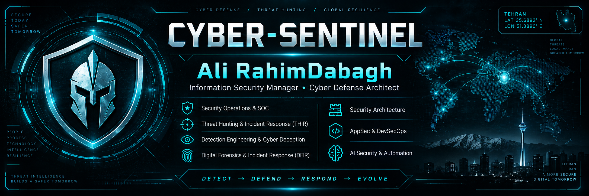
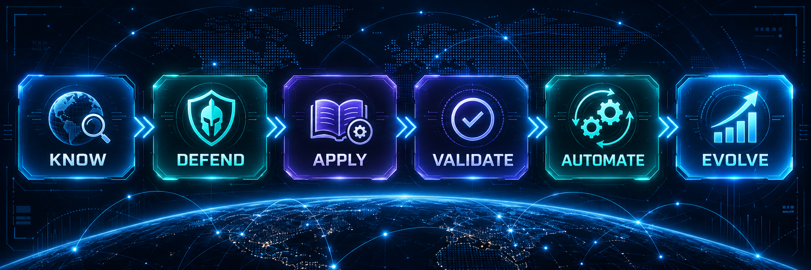

<!--
  CYBER-SENTINEL
  Public ecosystem landing page.
  Product repositories remain authoritative for implementation and release state.
-->

<p align="center">
  
</p>

<h1 align="center">Cyber-Sentinel</h1>
<p align="center"><strong>Evidence-Driven Cyber Defense Engineering</strong></p>
<p align="center">KNOW • DEFEND • APPLY • VALIDATE • AUTOMATE • EVOLVE</p>

<p align="center">
  <a href="https://github.com/cyber-sentinel/Cyber-Sentinel-Atlas"></a>
  <a href="https://github.com/cyber-sentinel/Cyber-Sentinel-DefenseOps"></a>
  <a href="https://github.com/cyber-sentinel/Cyber-Sentinel-Skills"></a>
  
  
</p>

Cyber-Sentinel is a contract-separated cyber-defense ecosystem for turning **trusted knowledge** into **validated defensive engineering** and then into **repeatable operating practice**. The goal is not to accumulate rules, notes, or automation fragments; it is to make security work attributable, testable, reviewable, and operationally defensible.

> **Product thesis:** Security knowledge should become defensible engineering. Defensible engineering should become repeatable operating practice. Operational evidence should feed back into better knowledge, detections, controls, and procedures.

## Ecosystem at a Glance

| Product | Role | Core question | Current public maturity |
| --- | --- | --- | --- |
| [**ATLAS**](https://github.com/cyber-sentinel/Cyber-Sentinel-Atlas) | **KNOW** | What do we know about what we are seeing — and what evidence supports it? | Engineering-ready Windows First Preview; MVP-2 candidate validated; Public Preview still gated |
| [**DefenseOps**](https://github.com/cyber-sentinel/Cyber-Sentinel-DefenseOps) | **DEFEND** | What can we detect, hunt, validate, and defend — and what evidence supports that claim? | Stable engineering baseline `0.1.0`; no published GitHub Release/tag |
| [**Skills**](https://github.com/cyber-sentinel/Cyber-Sentinel-Skills) | **APPLY** | How should a security task be performed consistently, safely, and verifiably? | Foundation v0.1 under controlled review; official release not authorized |

```text
Authoritative Sources / Telemetry / Security Knowledge
                         │
                         ▼
                  ATLAS — KNOW
        Connect • Search • Investigate • Explain
                         │
                         ▼
               DefenseOps — DEFEND
       Detect • Hunt • Validate • Respond • Automate
                         │
                         ▼
                  Skills — APPLY
          Execute • Review • Reuse • Govern
                         │
                         ▼
          VALIDATE → AUTOMATE → EVOLVE
                         │
                         └──────────────↺
```

<p align="center">
  
</p>

## ATLAS — KNOW

**Provenance-First Cyber Defense Knowledge & Investigation Platform**

ATLAS is the governed knowledge and analyst-investigation layer. It connects telemetry records, canonical entities, relationships, adversary behavior, defensive context, investigation pivots, and claim-level provenance while preserving source identity and trust boundaries.

### Current verified position

| Boundary | State |
| --- | --- |
| Microsoft-Windows-Security-Auditing | **423/423 encyclopedia-grade — COMPLETE** |
| Sysmon 15.22 | **30/30 encyclopedia-grade — COMPLETE** |
| PowerShell Operational | **43/43 in the validated MVP-2 candidate** |
| Integrated MVP-2 runtime corpus | **502/502 clean-Windows runtime acceptance** |
| Deterministic retrieval | SQLite + FTS5, exact-before-lexical |
| Verified content delivery | `.atlaspack` + TUF trust model |
| Shared Core | Go / bounded child-process stdio |
| Windows Desktop | Tauri 2.x; offline-first engineering preview |
| Product Owner interactive review | **PENDING** for the current MVP-2 candidate |
| Public Preview | **BLOCKED / fail-closed** until release gates close |

The PowerShell and `502/502` figures describe the current validated MVP-2 candidate workstream, not a claim that every item is already merged into the public `main` release authority. The global Windows denominator also remains intentionally unfrozen while additional mandatory telemetry families are brought under controlled coverage.

### ATLAS delivery family

`Desktop (Windows / Linux / macOS)` • `CLI` • `Web` • `PWA` • `API` • `Mobile`

Windows Desktop is the current release-critical surface. The other surfaces are approved delivery scope, not released-product claims.

## DefenseOps — DEFEND

**Evidence-Driven Cyber Defense Engineering**

DefenseOps treats defensive content as an engineering lifecycle rather than a rule collection. It owns detections, hunts, validation assets, DFIR/IR engineering material, response content, deception-oriented controls, and defensive automation with explicit telemetry, engine, evidence, tuning, and rollback requirements.

Current baseline highlights:

- Detection-as-Code and Hunt-as-Code;
- Sigma, YARA, Suricata, Snort and Zeek validation where applicable;
- SIEM/EDR query engineering with explicit backend identity;
- positive/negative synthetic validation fixtures;
- false-positive, blind-spot and deployment-boundary analysis;
- Hunt → Detection → Validation → Operational feedback.

A CI-green rule is evidence of a defined validation contract — **not** automatic production authorization.

## Skills — APPLY

**Governed Cybersecurity Operational Skills & Playbooks**

Skills converts analyst know-how into bounded operational contracts. A substantive Skill is expected to make purpose, authorization, prerequisites, inputs, procedure, decision points, evidence, stop conditions, rollback, outputs, references, and version history explicit.

The active Foundation v0.1 workstream is under controlled review and is intentionally separated from release authority. Human accountability, environment-specific authorization, and evidence requirements remain mandatory even when a procedure is machine-readable or AI-assisted.

## Engineering Principles

1. **No material technical claim without provenance.**
2. **Deterministic evidence precedes optional semantic augmentation.**
3. **Detection and defensive content must be measurable and testable.**
4. **Automation must preserve evidence and decision boundaries.**
5. **Security controls must survive production reality.**
6. **Offline and restricted environments are first-class design conditions where relevant.**
7. **Canonical contracts do not drift for implementation convenience.**
8. **Trust, update, rollback, signing, and release boundaries are explicit.**
9. **Human accountability remains intact in assisted operations.**
10. **Product maturity follows executable evidence, not marketing language.**

## Where the Products Meet

| Flow | Contract |
| --- | --- |
| ATLAS → DefenseOps | Evidence-backed knowledge and context may inform defensive engineering; origin alone never grants production authority |
| DefenseOps → Skills | Validated engineering artifacts may become repeatable procedures; Skills does not redefine detection ownership |
| Skills → ATLAS | Operational outcomes and lessons may become governed knowledge only through ATLAS provenance and validation boundaries |
| All products | Versioning, attribution, authorization, review, and release authority remain explicit |

## Primary Security Domains

`SOC / THIR` • `Detection Engineering` • `Threat Hunting` • `DFIR / Incident Response` • `Threat Intelligence` • `Security Automation / SOAR` • `Cyber Defense Architecture` • `AppSec / SSDLC / DevSecOps` • `IAM / PAM` • `Endpoint / Network / Cloud / Container Security`

### Selected technologies and frameworks

`Go` `Python` `PowerShell` `Bash` `Rust` `SQLite/FTS5` `Tauri` `GitHub Actions` `Docker` `Kubernetes`

`Splunk` `Wazuh` `MISP` `Sigma` `YARA` `Sysmon` `Zeek` `Suricata` `Snort`

`MITRE ATT&CK` `MITRE D3FEND` `MITRE CAR` `NIST CSF` `NIST SP 800-61` `CIS Controls` `ISO/IEC 27001` `OWASP`

## Maturity Model

| State | Meaning |
| --- | --- |
| **Foundation** | Product contracts and governance exist; operational coverage is still forming |
| **Engineering Ready** | Defined implementation and engineering-verification gates have passed |
| **Public Preview Ready** | Release-specific security, licensing, redistribution, packaging, accessibility, signing, and publication gates have passed |
| **Production Deployment** | Environment-specific approval after customer/organization validation and change control |

Public source visibility, passing CI, or an engineering preview is **not** represented as GA or universal production readiness.

## Repositories

- **KNOW** — [Cyber-Sentinel-Atlas](https://github.com/cyber-sentinel/Cyber-Sentinel-Atlas)
- **DEFEND** — [Cyber-Sentinel-DefenseOps](https://github.com/cyber-sentinel/Cyber-Sentinel-DefenseOps)
- **APPLY** — [Cyber-Sentinel-Skills](https://github.com/cyber-sentinel/Cyber-Sentinel-Skills)

---

<p align="center"><strong>Ali RahimDabagh</strong></p>
<p align="center">Information Security Manager • Cyber Defense Architect</p>
<p align="center"><strong>Know. Defend. Apply. Evolve.</strong></p>
